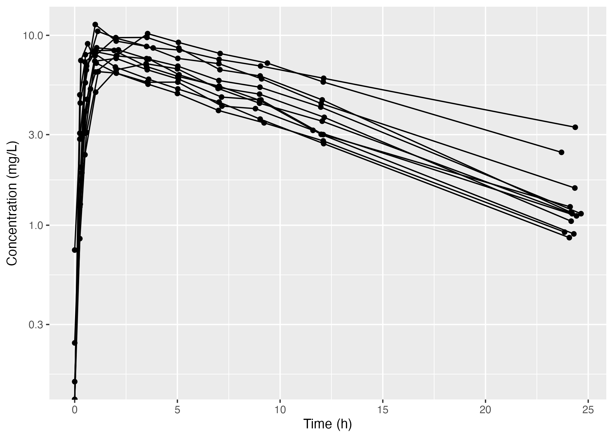
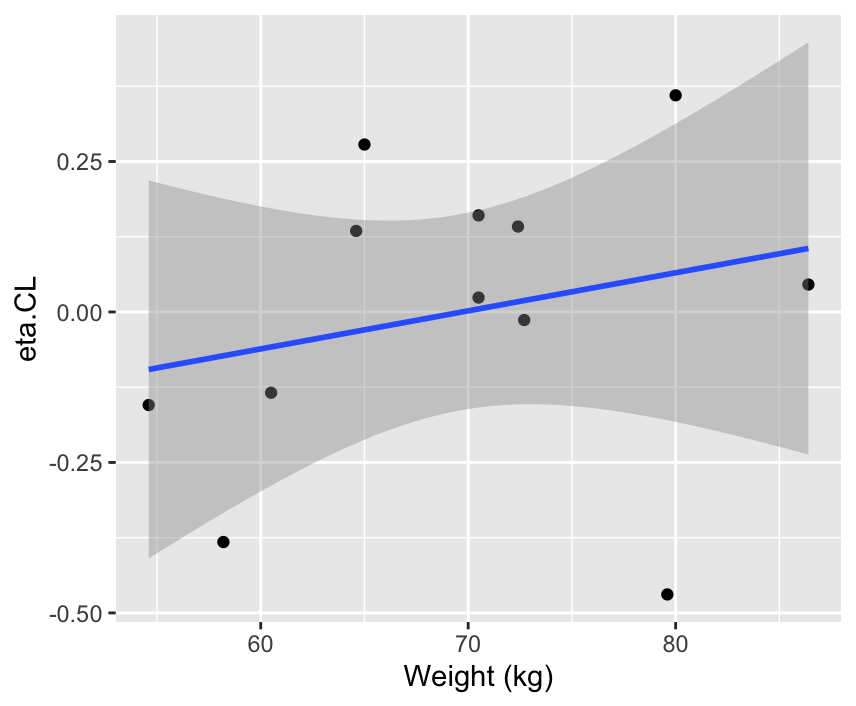
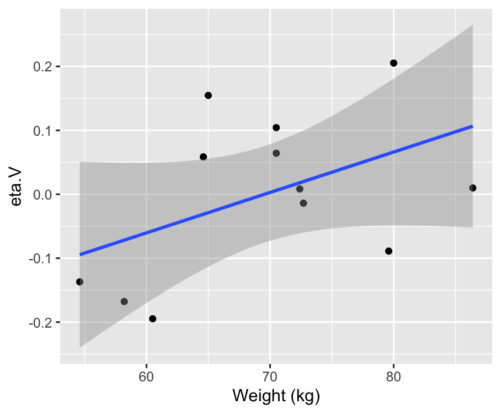
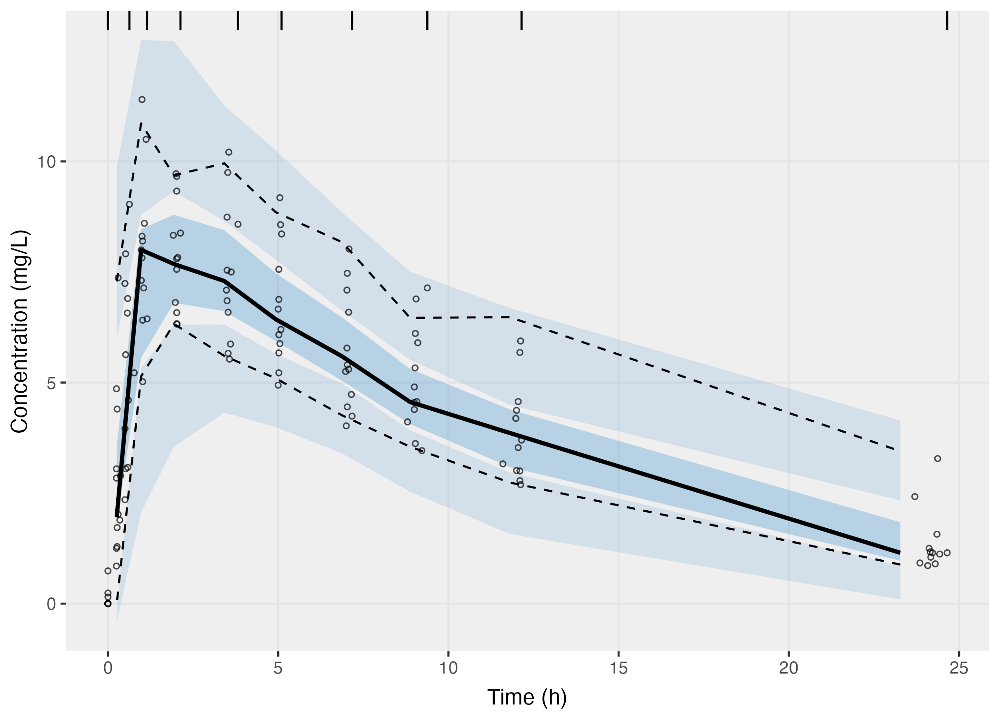
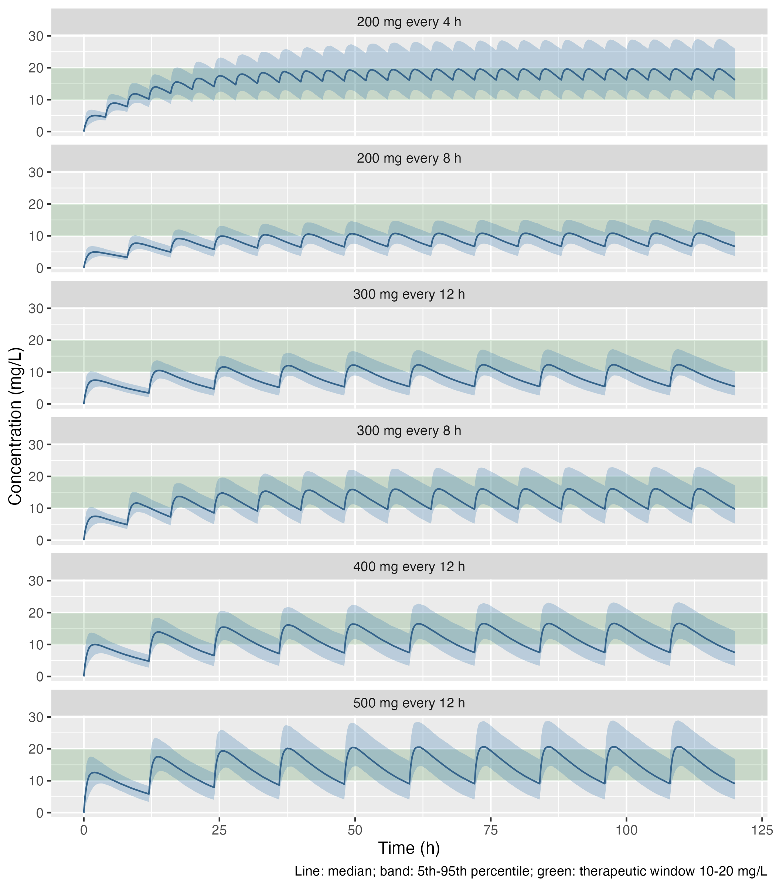

# Theophylline-PK
This project develops a population pharmacokinetic (PK) model of theophylline in R with [nlmixr2](https://nlmixr2.org/), evaluates it with diagnostic plots and a visual predictive check (VPC), and uses it to simulate dosing regimens against the therapeutic window.

Theophylline is a bronchodilator used in asthma and chronic obstructive pulmonary disease. It has a narrow therapeutic window: plasma concentrations between 10 and 20 mg/L are effective, while concentrations above 20 mg/L carry a risk of serious toxicity. The question addressed here is therefore:

> **Which dosing regimen keeps most patients within 10-20 mg/L at steady state?**

## Data

The dataset (`theo_sd`, provided in the `nlmixr2data` package) is a classic pharmacometrics dataset: 12 subjects received a single oral dose of theophylline (about 4-5.5 mg/kg) and plasma concentrations were measured over 24 hours. Body weight is available for each subject.

<p align="center"></p>

After the dose, concentrations rise quickly (peak within about 1-2 h), then decrease approximately linearly on a log scale (see the picture above), which is consistent with a one-compartment model with first-order absorption and elimination. The visual estimate of the half-life is about 7.5 h.

## Model

The drug is absorbed from the gut into a central (blood) compartment and eliminated from it:

$$\frac{dA_{gut}}{dt} = -k_a A_{gut}, \qquad \frac{dA_{blood}}{dt} = k_a A_{gut} - \frac{CL}{V} A_{blood}, \qquad C = \frac{A_{blood}}{V}$$

where $k_a$ is the absorption rate constant, $CL$ the clearance, $V$ the volume of distribution and $C$ the plasma concentration (amount in the central compartment divided by $V$). The dose does not appear in the equations: each dosing record of the data (EVID = 1) adds the amount AMT to the gut compartment at the dosing time.

Each individual parameter follows a log-normal distribution, $\psi_i = \psi_{pop}\, e^{\eta_i}$ with $\eta_i \sim \mathcal{N}(0, \omega^2)$. Parameters are estimated with the SAEM algorithm.

### Model development

| Model | Change | AIC | OFV |
|---|---|---|---|
| base | additive residual error | 379.1 | 122.5 |
| wtV_fix | + weight on V, exponent fixed to 1 | 371.8 | 115.2 |
| wtV_fix_prop | + proportional error | 391.1 | 134.5 |
| wtV_fix_comb | + combined (additive + proportional) error | 362.1 | 103.5 |

- **Weight on V.** The random effects of V and CL tended to increase with body weight (correlation with weight 0.47 for V, p = 0.12; 0.24 for CL, p = 0.45).
  
<p align="center">
  
  
</p>

Weight was added on V as $V_i = V_{pop}\,(WT_i/70)^{\beta}\, e^{\eta_{V,i}}$, which is physiologically plausible since theophylline distributes in body water, which increases with body size. It was not added on CL, because the data showed no clear relationship (Pearson correlation coefficient r = 0.24, p-value p = 0.45). When estimated, the exponent was imprecise ($\beta$ = 0.58, 95% CI 0.08-1.09) but compatible with the physiological value of 1, so it was fixed to 1, which also removes one parameter. A correlation between $\eta_{CL}$ and $\eta_V$ remains and is not explained by weight, possibly because of the small number of subjects.
- **Residual error.** The VPC of the additive-error model showed an overestimated variability at low concentrations and negative simulated concentrations. A combined error model corrects this and lowers the objective function. A purely proportional error cannot describe the non-zero pre-dose concentrations observed in some subjects.

### Final model

| Parameter | Estimate (95% CI) | Between-subject variability (CV%) | %RSE |
|---|---|---|---|
| $k_a$ (1/h) | 1.50 (1.01-2.23) | 75.9 | 49.4 |
| $CL$ (L/h) | 2.75 (2.37-3.19) | 26.0 | 7.5 |
| $V$ for 70 kg (L) | 32.2 (29.7-34.9) | 12.2 | 1.2 |
| additive error (mg/L) | 0.27 (0.17-0.37) | | 19.0 |
| proportional error | 0.13 (0.10-0.17) | | 12.8 |

The estimated half-life, $\ln 2 \cdot V / CL$, is about 8 h, consistent with the visual estimate and with literature values for adults.

## Model evaluation

The VPC compares the 5th, 50th and 95th percentiles of the observed concentrations (lines) with the 95% confidence intervals of the same percentiles in 500 simulated replicates of the study (shaded areas).

<p align="center"></p>

The observed median and percentiles lie within their confidence intervals: the model reproduces both the typical profile and the between-subject variability. A small region below zero remains at very early times, where the additive part of the error dominates.

## Simulation of dosing regimens

A virtual population of 1000 patients was simulated, with weights resampled from the 12 observed subjects and individual parameters drawn from the estimated distributions. Each regimen was given for 5 days to reach steady state, and the last dosing interval was analysed: a patient is within the window if the trough is at least 10 mg/L and the peak at most 20 mg/L.

| Regimen | Daily dose (mg) | In window (%) | Trough < 10 mg/L (%) | Peak > 20 mg/L (%) |
|---|---|---|---|---|
| 300 mg every 12 h | 600 | 4.7 | 94.0 | 1.6 |
| 200 mg every 8 h | 600 | 10.1 | 89.5 | 0.4 |
| 400 mg every 12 h | 800 | 7.5 | 78.0 | 19.8 |
| 300 mg every 8 h | 900 | 30.5 | 49.8 | 19.7 |
| 500 mg every 12 h | 1000 | 4.0 | 58.6 | 60.4 |
| 200 mg every 4 h | 1200 | 46.9 | 5.4 | 47.7 |

<p align="center"></p>

- At the same daily dose, shorter dosing intervals reduce the fluctuation between peak and trough (200 mg every 8 h vs 300 mg every 12 h).
- None of the regimens tested is satisfactory: lower daily doses leave about half of the patients or more below 10 mg/L, while higher doses bring a large fraction above 20 mg/L, because of the between-subject variability in clearance.
- Because exposure above 20 mg/L carries a risk of serious toxicity, a conservative starting regimen such as 300 mg every 8 h (20% above 20 mg/L) is preferable to 200 mg every 4 h (48% above 20 mg/L), followed by dose adjustment based on measured concentrations.

These results support individualised dosing guided by drug monitoring, or sustained-release formulations that reduce the peak-to-trough fluctuation.

## Limitations

- Only 12 subjects were studied: the absorption rate constant is estimated with low precision (RSE 49%).
- The data come from a single dose, while the simulations assume that the parameters stay the same after repeated doses. Theophylline elimination can become saturated at high concentrations; in that case the model underestimates accumulation and the risk of exceeding 20 mg/L.
- The correlation between the random effects of CL and V is not explained by the covariates available.
- The simulations use the estimated population parameters as if they were exact, so the percentages in the table do not include the uncertainty of the estimates.
- The simulated regimens use the immediate-release absorption observed in these data.

## Project files

The R scripts are in the Code/ folder. 
- `models.R` defines the models (base, weight on V, proportional error, combined error) and the function `save_fit()`, which saves criteria, parameters and diagnostic plots of a fit.
- `01_exploration.R` plots the data.
- `02_fit_models.R` estimates the models, writes the comparison table in `results/model_comparison.txt` and saves the final model in `results/fit_final.rds`.
- `03_diagnostics_vpc.R` produces the VPC of the final model.
- `04_simulation.R` simulates the dosing regimens and writes `results/dosing_simulation.txt`.
- `results/` contains the estimated parameters and criteria of each model; `Figures/` contains the plots.

## Run project

The code was run with R version 4.6.2 and nlmixr2 7.0.1. Install the packages with:

```r
install.packages(c("nlmixr2", "ggplot2"), dependencies = TRUE)
```

nlmixr2 compiles the models, so a C compiler is needed (on macOS, the Xcode command line tools and gfortran; see the [nlmixr2 installation page](https://nlmixr2.org/)).

Run the scripts in order: `01_exploration.R`, `02_fit_models.R`, `03_diagnostics_vpc.R`, `04_simulation.R`. Script 02 takes a few minutes; scripts 03 and 04 load the final model from `results/fit_final.rds` and do not repeat the estimation.

Author: Giorgia Ciavolella, 2026
